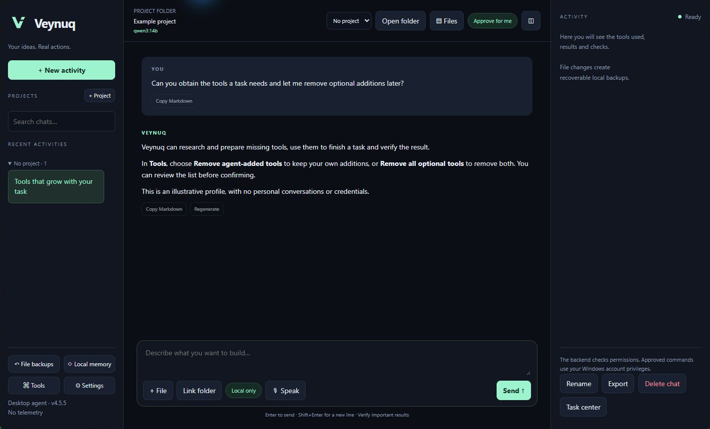
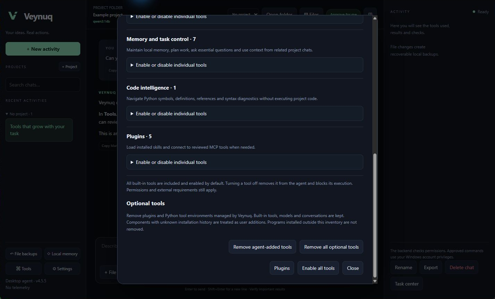
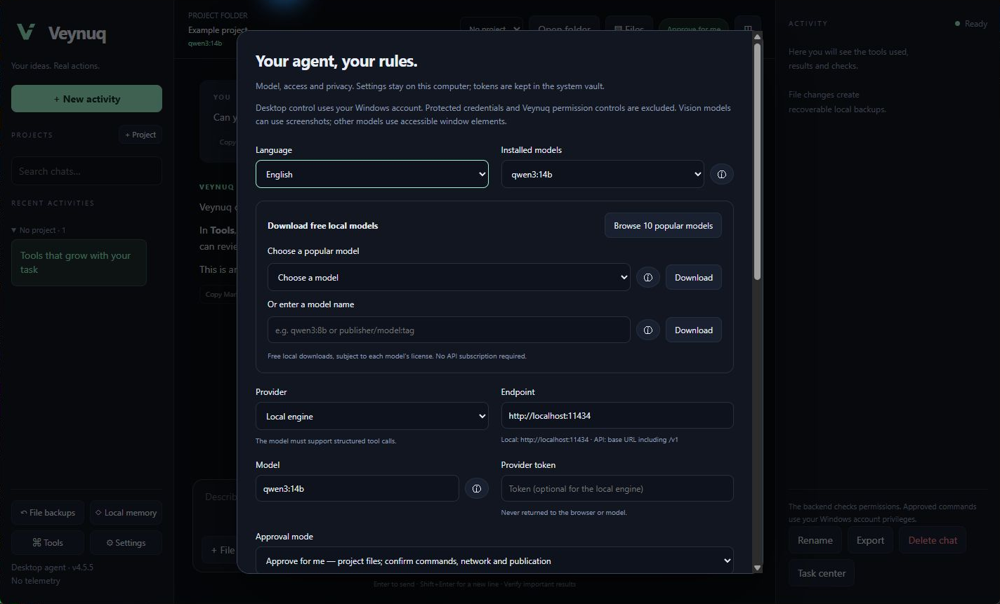

# Veynuq


Veynuq (pronounced “VAY-nook”) is an independent Windows desktop AI agent. It works with local models or a Chat Completions compatible API, and uses backend tools to act on files, projects, GitHub, the web and accessible Windows applications.

## Quick installation

Requires **Windows 10/11 x64** and approximately **5 GB free disk space** for the built-in image engine. The installer obtains the latest stable Python release when needed.

1. Download **`veyq-update.zip`** from [the latest release](https://github.com/gabriele-gaudissard/Veynuq-Agent-App/releases/latest), under **Assets**.
2. Extract the complete ZIP to a writable application folder outside your working projects.
3. Open **`Installer.bat`** once. It configures dependencies, updates, the local image generator and the Desktop shortcut. The first image-model download is approximately 4.3 GB.
4. Launch **Veynuq** from the Desktop and choose an installed model or download one in Settings.

Use the release ZIP for installation. GitHub's **Source code** archives and **Code → Download ZIP** contain the repository checkout, including publishing files. Node/npm and test files are not needed by users. Keep the extracted application files together: they support the app and its future updates.

## See Veynuq

Three screenshots of Veynuq 4.5.5 running on Windows in English with an isolated demo profile, including the local dictation button and optional-tool cleanup controls. The illustrative conversation contains no personal chat or credentials and is not a benchmark. New profiles start in English.

**Workspace and conversation** — both user and agent messages are aligned left; the composer stays visible while history scrolls.



**Optional tools** — remove only agent-added components or all optional additions, with a preview before confirmation. Built-in tools, models and conversations are kept.



**Models and settings** — installed models, the ten-model download selector, custom names and information beside each model. Permissions and provider credentials are further down the same panel.



The [brand assets](assets/brand) include original [dark](assets/brand/logo-dark.svg) and [light](assets/brand/logo-light.svg) SVG/PNG logos and a Windows icon. The Desktop shortcut uses the dark icon.

## What it does

- **Tools on demand:** research and install a missing Python tool or supported marketplace plugin, then use it to finish and verify the task. Installation follows your selected approval mode; accounts are requested only when needed.
- **Optional-tool cleanup:** keep your own additions while removing agent-added tools, or remove all optional components managed by Veynuq. Both choices show the exact list before confirmation.

The backend owns the model → tool → result loop. Markdown code fences never execute commands. Actions use validated structured tool calls, and failures return the actual error/output to the model for correction.

- **Code and projects:** read/search/write/edit files, run PowerShell commands and tests, inspect Git, clone public repositories and configure their dependencies. Commands report exit codes; shell directory changes persist across commands and restarts.
- **Files and documents:** create folders, move/delete individual files with recoverable backups, restore backups, preview files and images, extract PDF/DOCX text, attach files with bounded text excerpts, and link folders. Documents, spreadsheets and charts can be created through project Python code and the required libraries.
- **Mouse and keyboard:** list visible Windows applications, inspect accessible controls, click, double-click, right-click, drag, scroll, type literal text and send shortcuts. Input is bound to a verified live control and mouse points are checked against the actual target window. Failed argument validation preserves the observation; successful input requires a new inspection. Slow model responses can refresh an older observation only after the same live control identity is verified. Read-only and password fields are protected. Vision-capable models can receive requested window screenshots; other models use the accessibility tree.
- **Browser and downloads:** operate a separate Edge browser through observed page elements, fill ordinary fields, click, choose options, scroll and use shortcuts. Its worker can be stopped independently. Public file downloads support optional SHA-256 verification and preserve existing content before replacement. No plugin or account is required for public pages. Private services may require the user's own sign-in; password fields are not filled by the agent.
- **Online and GitHub:** DuckDuckGo search with Bing fallback, public URL reading, and GitHub REST reads/writes for any requested repository. The configured repository is an optional default, not a restriction. GitHub itself enforces the token’s permissions.
- **Conversation:** projects with accordion groups, full-text chat search, rename/delete/export, persistent editable memory, paginated access to other chats in the same project, Markdown tables/lists/highlighting, copy and regeneration. Titles wrap instead of being cut in half. Deleting removes the session itself and leaves the welcome screen when no chats remain.
- **During a run:** live text and colored tool logs, task plans, targeted questions, immediate follow-ups, and Stop when the composer is empty. Stopping preserves partial text and completed actions.
- **Models:** installed-model dropdown, a ten-family catalog, custom-name download, progress/cancellation, deletion, source links and approximate RAM/VRAM/size/use-case details.
- **Distribution:** tested main-branch pushes create signed GitHub Releases; managed installations download and apply updates automatically when idle.

The main repository contains the application, user documentation, brand assets, third-party licenses and the GitHub publishing workflow. Tests, Node test dependencies, brand-generation scripts and temporary/private files are excluded by `.gitignore`. The installer package includes only the application and user-facing assets; Python is prepared automatically, and Node/npm are not needed for built-in tools.

The **Tools** menu lists all 49 integrated tools by category. They are included and enabled by default. Each can be disabled individually; this removes it from the model catalog and blocks backend execution. The selection persists across restarts. Enabling a tool does not bypass the selected permission mode or its external prerequisites. Requests to execute work trigger tools rather than a tutorial. If a model produces an instruction-only draft, Veynuq retries twice with an execution reminder and then reports that it could not complete and verify the request. Compatible APIs request required tool calls where appropriate. This improves execution behavior but does not make every local model equally capable or reproduce proprietary agent services.

Browser control reuses installed Microsoft Edge through Playwright. Its separate local profile is inside the private data folder and can contain site cookies; it does not take over your everyday browser profile. Only an explicitly opened loopback development server on a port of 1024 or higher is allowed locally; other private/reserved destinations are blocked. Browser traffic is checked through request routing rather than the DNS-pinned transport used by structured URL/download tools, so these controls are not a network sandbox. No external plugin or account setup runs on launch. AI image generation uses a separate image model. Settings can prepare the verified built-in local engine, or connect to an existing image API.

## Install and launch

Windows 10/11 is required. Python is checked and prepared by the installer. A tool-capable local model is sufficient; a paid API is optional.

Follow **Quick installation** above. A new profile starts in **English**. Choose a 7B, 8B or 14B starter model, another catalog model, an installed model, or a remote API.

Model downloads require your explicit choice. If the default local engine is missing, the confirmed download starts the official installer, verifies its Windows publisher signature and starts the engine. An already running engine is reused. Installer failures preserve the application and are reported. Engine installation requires network access and a valid publisher signature; this path is not needed on an already configured PC.

The installer creates Desktop and Start menu shortcuts with the dark seven-size Windows icon and verifies that the icon exists. The shortcut launches without a terminal window. `Veynuq.bat` also launches the app; opening a batch file directly may briefly show its shell. Missing Python packages are repaired automatically on launch, with diagnostics in `startup.log`. To repair only the shortcuts, open PowerShell in the application folder and run `powershell -NoProfile -ExecutionPolicy Bypass -File .\install.ps1 -ShortcutOnly`; this preserves the installed runtime and your data.

Settings includes a visible selector for 10 popular free local model families, a custom model-name download field and an information button beside each model. Details distinguish catalog estimates from live installed metadata, including parameters, quantization, maximum context, license, native tools, images and estimated hardware fit. Popular families are curated rather than presented as an unverified global usage ranking. Models without native tool support serve chat and analysis; choose Qwen3 or another tool-capable model for autonomous work.

You can switch existing chats while an agent works and return to the partial response. One run executes at a time; the composer offers a return button when you view another chat. The chat menu includes **Add to project**, with a project picker.

The local protocol uses `/api/chat`, `/api/tags`, `/api/show`, `/api/pull` and `/api/delete`. Compatible APIs use `/chat/completions` and `/models`; include `/v1` where required. Remote endpoints require HTTPS and online access. Local unauthenticated endpoints need no token. Remote vision input is an explicit setting.

The catalog contains curated popular families, not a measured popularity or performance ranking. Hardware figures assume typical quantized weights and are estimates: context, quantization and GPU offloading change requirements. CPU-only inference works but can be slow. Models without native tools work as chat models; select a tool-capable model for autonomous actions.

## Language, follow-ups and optional limits

English, Italian, Spanish and French apply immediately and persist across restarts. The model receives the selected response language. Model-generated prose, filenames, source code and raw operating-system/tool output are preserved rather than translated by the UI.

Type while the agent works to send a **follow-up**. During a model response it interrupts the stream and replans within the same activity. An already executing command reaches its completion; remaining calls from the old batch are marked as skipped before the new instruction is processed, keeping tool/result pairing valid. Leave the composer empty to **Stop**. Regeneration removes later chat messages but does not undo previously executed actions; inspect the result before repeating work.

**Maximum steps: `0` means unlimited. Command timeout: `0` disables the command timeout.** New profiles default to both disabled. You can enable finite values in Settings. Stop, window-close cleanup, output-size validation and repeated-identical-action protection remain active. Network transports retain connection/read timeouts so unavailable services do not hang forever.

## Approval modes

| Mode | Behavior |
| --- | --- |
| Always ask | Each action tool requires one explicit approval; asking an essential question itself does not need a second approval. |
| Approve for me | Project file reads/changes proceed automatically. System changes, commands, desktop/browser control, downloads, backup restoration, outside-project access, deletions, memory writes, other-chat context, online requests and GitHub writes require approval. |
| Full access | Actions proceed without confirmations, subject to validation and the online switch. Enabling it requires an explicit checkbox. |

These are application permission gates. In **Windows host** mode, shell commands run as the current Windows user and can access other files and network services. The separate offline command sandbox described below uses Docker isolation; file tools and desktop actions continue to use their own host permission gates. Structured file tools protect recognized credential locations and the app data folder, but arbitrary approved shell commands cannot provide the same isolation. Full access does not elevate Windows privileges. GUI controls in password-manager/system-security apps and Veynuq’s own permission UI are protected; inaccessible or elevated applications may require a different approach.

Approval is tied to one action and exact parameters. File changes while approval is pending invalidate it. Denials are returned to the model and recorded. Configuration/project mutations are blocked during work; follow-ups and question answers remain available. Stop interrupts the model connection and terminates command process trees. A window-close handler performs the same cleanup even with command timeouts disabled. Completed side effects remain applied.

## Speak instead of typing

Press **🎙 Speak** beside the message field. On first use, confirm **Download speech model** to obtain the pinned multilingual base model (about 150 MB) from Hugging Face. This is separate from the chat model; no account is needed. Press **Speak** again to begin recording, then **Stop recording** to transcribe. Recording is visibly indicated and automatically stops after two minutes. **Cancel dictation** discards the recording/transcript and terminates the dedicated worker. Closing the app also stops it.

Transcription runs locally on CPU using faster-whisper/CTranslate2 and automatically detects the spoken language. Once prepared, it works without a network connection; audio stays in memory and is not uploaded or saved. The text is appended to the message box for editing and **is never sent automatically**. During an agent response it can be sent as a normal immediate follow-up. Switching conversations cancels dictation to keep transcripts out of another chat. Windows microphone permissions and an available recording device are required; accuracy depends on speech clarity and background noise. The two-minute recording cap is separate from the optional agent step/command limits.

## Long tasks, review and controlled execution

**Task center** shows saved progress and lets you resume an interrupted, cancelled, failed or step-limited activity. Full history stays on disk; older exchanges are condensed into bounded observations for the model. The agent can save decisions, verification and next steps with `checkpoint_task`. After a crash, dispatched tools without recorded results are marked **outcome unknown** and are never automatically replayed. Resume asks the model to inspect the real state first. This is application context management, not a guarantee of the model's reasoning quality.

**Review changes** displays additions and removals with separate colors, including unstaged, staged and new Git files. Outside Git, it compares available file backups. Sandbox changes are shown separately through the agent's review tool and are also included in Task center. Binary and large output is bounded. Review does not publish or merge anything.

Six reusable procedures cover coding, desktop work, repository setup, code review, documents and obtaining missing tools. Up to three model workers can investigate independent questions concurrently. Workers can only read/search/list files inside the selected project; they cannot execute commands, write files, browse, control the PC or delegate again. The main agent performs the changes. `git_worktree` creates a separate generated branch and sibling checkout from a clean repository, with checkout hooks disabled. Select that folder as the project for isolated coding and review before merging.

In **Settings → Command environment**, select **Offline sandbox** to execute Linux `/bin/sh` commands on a filtered disposable project copy. This requires an installed, running local Docker Linux engine and the cached `python:3.13-slim` image. To prepare the image, run `docker pull python:3.13-slim` after installing Docker. Veynuq refuses remote Docker endpoints and never falls back to Windows host execution when isolation is unavailable. Containers have no network, a read-only root, dropped capabilities, no new privileges, an unprivileged user, and process/CPU/memory limits. Only the disposable copy is mounted. Credentials, profile data, Git metadata and dependency folders are excluded. Copies are limited to 20 MB, 2000 files and 2 MB per file; output size is monitored, not a filesystem disk quota. Sandbox mode is suitable for small code tasks; it is not a Windows GUI virtual machine.

Sandbox edits are held in the local profile and survive restarting the app. Use `sandbox_changes` to review/apply them. Application checks the original host hashes, refuses overwriting externally changed files, creates backups and rolls back partial application failures. Auto/always approval shows the actual diff before applying. Full access follows the user's selected approval policy. File/desktop tools remain host actions: selecting the command sandbox does not isolate all PC interaction.

**Read-only schedules** run project checks with the selected model while Veynuq is open, at intervals from 1 to 168 hours. Missed checks run once on the next launch; failed or interrupted runs pause for review. Scheduled checks cannot execute commands, change files, browse, use GitHub or control the desktop, even when the app normally has full access. They use at most 12 model turns and remain read-only when resumed. A remote selected provider still receives the permitted context. Schedules can be paused, enabled or removed; deleting a chat removes its schedules. Running with the app closed requires explicitly enabling the visible Windows scheduled task described below; it is disabled by default.

## GitHub and updates

The GitHub tool accepts `repository: "owner/name"` for each action. Settings can hold an optional default. A token is only necessary for private data and authenticated writes; use a fine-grained token with the permissions you need. It stays in the backend vault and is injected into requests. Git credential-manager authentication for command-line Git is separate.

Pushing changes to **main** runs Windows backend tests, UI tests, syntax checks and a real isolated Linux Docker test before publishing a release. An unpushed local edit or another branch does not update users. Installed packages check at startup and hourly, stage the new version and restart when idle. This independent update check contacts GitHub even if the agent’s online tools are off; disable automatic updates too when avoiding outbound traffic. Explicit model downloads and engine setup also contact their publishers after confirmation.

Every update manifest is **Ed25519 signed** against a pinned publisher key, checked before staging and again before applying. The updater verifies SHA-256 hashes, rejects unsigned/tampered manifests, archive traversal/links and older release sequences, preserves user data, backs up app files and rolls back a failed installation. Changed dependencies install into a separate runtime before switching. Offline/download/rate-limit failures leave the current app installed.

The update publisher is `gabriele-gaudissard/Veynuq-Agent-App`; this fixed trust source is independent of the repositories the agent works on. The signing private key is an Actions secret, with a publisher backup in the Windows vault, and is never distributed. The package signature is not a Windows Authenticode certificate.

Developer checkouts with `.git` use Git updates and are never overwritten by the package updater. Modified managed app files also pause updates to preserve changes. Users of the original application install this version once because the original has no updater. Earlier Veyq packages also require a one-time installation of this renamed release: their updater trusts the old repository URL and file list. Subsequent Veynuq releases update automatically.

## Privacy and recovery

Data defaults to `%LOCALAPPDATA%\Veynuq`, with `VEYNUQ_DATA_DIR` and the legacy `VEYQ_DATA_DIR` overrides supported. Existing Veyq profiles are reused. Installation records the physical profile path in local `profile.json` so Windows filesystem redirection does not create separate profiles for different launchers. This machine-specific file is preserved during updates and is never distributed. Legacy `codex_data.json` is imported once, retaining chats/projects/preferences and migrating the provider token into the vault. The legacy token field is scrubbed after vault storage succeeds.

Chats, settings, memory and backups are local plaintext files protected by the Windows account. Tokens are separately encrypted with current-user DPAPI. The metadata-only audit log records tool names/outcomes/digests, not chat contents. There are no analytics, external fonts or runtime CDN scripts; Markdown/highlight/sanitizer libraries ship locally with licenses. A remote provider receives the context and, when enabled/requested, screenshots needed for the task.

Corrupt JSON is preserved under a separate filename. The app restores the previous valid snapshot, or creates a clean profile if no valid snapshot exists, and displays a recovery notice. Recognized token patterns/configured credentials are redacted from output and logs; this is not a universal secret detector. Structured web tools block private/reserved network addresses and validate DNS/redirects. Missing Beautiful Soup disables web extraction/search rather than crashing the whole app.

## Autonomy and creative tools in 4.2

The agent now checks the local engine’s installed tool capabilities rather than relying only on catalog estimates. Local context/response budgets are configurable; the requested context is capped by the model metadata when available. Successful repeated reads are not counted as repeated failures. Temporary model connection/backend interruptions retry the current response up to twice without replaying accepted tool actions. Automatic chat titles end at a word boundary with an ellipsis when limited to 100 characters; manually named chats are preserved. After mutations the agent requests an inspection before completing; when verification is missing it records **unverified**, with a resumable task, rather than recording a completed activity. A read result is evidence for the model to assess, not a guarantee that every user requirement has been met.

`computer_wait` waits for observed UI text/value with cancellation and a bounded timeout. Windows Sandbox scope limits desktop targeting to the supported native sandbox client and rejects other host windows. Canvas typing is only available within that scope after a fresh screenshot and a vision capability check; host applications retain editable-field restrictions.

`windows_sandbox` creates a filtered project copy and starts an already available Windows Sandbox. Network, clipboard, microphone, camera, printer and GPU sharing are disabled, Protected Client is enabled, and the only mapped folder is read-only. The guest may copy inputs internally for editing; guest changes disappear on closing and are not automatically exported to the host. Preparing the configuration does not enable Windows features or install a hypervisor. Windows edition, feature and virtualization requirements remain external prerequisites. This scope restricts desktop tools; project file tools and command execution retain their separate permissions. [Windows Sandbox configuration reference](https://learn.microsoft.com/en-us/windows/security/application-security/application-isolation/windows-sandbox/windows-sandbox-configure-using-wsb-file).

An opt-in setting registers a visible per-user Windows scheduled task for read-only project reviews while Veynuq is closed. It checks every five minutes while that user is signed in, uses no administrator privileges or saved Windows password, verifies the installed files, and takes the same exclusive profile lock as the app before loading state. Opening the app asks the worker to stop. Background runs have a four-minute limit, cannot install dependencies, execute commands, change project files, control the desktop or wait for absent approvals. Failed/interrupted schedules pause for review. A selected remote model still receives its required context. There is no activity while the user is signed out or the PC is off.

Image generation uses a separately configured, already running local Stable Diffusion API or an HTTPS compatible `/images/generations` API. It is disabled by default. A local engine requires no account; a remote service may require an API key stored separately in the vault and may charge for generation. The app does not download a multi-GB image model or create a subscription automatically. Prompts are sent only to the configured engine. Generation runs in a cancellable process, bounds responses, validates/re-encodes actual pixels to PNG, checks the destination again, and backs up replacements. Stopping prevents the local output write; the remote provider may still finish its request. Actual generated files can be previewed from the task center without allowing arbitrary Markdown HTML or remote image embeds. [Local image API reference](https://github.com/AUTOMATIC1111/stable-diffusion-webui/wiki/API), [compatible images API reference](https://developers.openai.com/api/reference/resources/images/methods/generate).

The native window now loads a self-contained, nonce-protected local interface rather than relying on a localhost asset server. This avoids blank or partly initialized windows when local asset requests fail. Project-group expansion is saved in the local profile, and copying has a native-compatible fallback when the browser clipboard API is unavailable. The four UI languages include the new settings. These changes do not turn a small model into a frontier model or guarantee successful control of every third-party application.

## Tools on demand and optional cleanup in 4.5.5

When a task needs an additional capability, the agent can research official documentation, inspect a public PyPI package with `tool_setup`, install it into a separate profile-managed Python environment and use its returned interpreter or commands to complete the task. The native pip resolver selects compatible wheels; every distribution is matched to official PyPI metadata, pinned by exact version and SHA-256, then installed with hash checking. Source builds and arbitrary download hosts are excluded from this installer. Downloads are limited to 100 MB per wheel and 250 MB per resolved set. These environments isolate dependencies, **not Windows privileges**; third-party packages still require a trusted source. Other native toolchains can use official installers through the existing command permission gate.

The `plugin_marketplace` tool searches public GitHub marketplaces, reviews an immutable source commit and installs the reviewed plugin. It uses the existing plugin runtime and normal network/approval settings. Full access allows task-relevant installation without another confirmation; other modes keep their approval gates. Disabled tools/plugins and the offline command sandbox cannot be bypassed. Accounts are requested only when the selected service actually needs them. Installation alone is not proof that the original task succeeded: the agent must use the tool and verify its output.

In **Tools → Optional tools**, **Remove agent-added tools** keeps manually installed plugins and all components with unknown installation history. **Remove all optional tools** removes both user and agent additions. Each button previews the exact list before confirmation; a changed inventory invalidates the preview. Cleanup removes profile-managed plugins (including their saved credentials) and optional Python environments. Built-in tools, models, conversations, memory and generated project files are kept. Globally installed applications and packages outside this inventory are not removed. Newly installed components record their user/agent origin across restarts.

## File reading and local HTTP completion in 4.5.4

`read_file` reads UTF-8 (with or without a BOM) and BOM-marked UTF-16 text. Unsupported file content produces a readable diagnostic instead of a raw decoder exception. PDF/DOCX and image files use their dedicated tools. Rejected reads do not alter the file or count as verification of a completed edit.

The local model client consumes the HTTP response to its end after the final JSON line, preserving cancellation and checking unexpected trailing data. Closing a fully consumed response lets the connection be reused normally. Existing bounded retries remain available for backend socket resets; persistent upstream failures still report an error. This does not claim every reset in Ollama is eliminated.

## Windows model connection recovery in 4.5.3

Windows socket resets reported as `wsarecv` during local model tokenization now use the existing bounded response retry, including when the operating-system error text is translated. Completed tool results are preserved and their actions are not replayed. Authentication, invalid configuration and unrelated HTTP 500 errors remain failures. This recovers transient connections; persistent model or GPU errors still require diagnosis.

## Default image engine in 4.5.2

`Installer.bat` now prepares the built-in SD 1.5 CPU image engine automatically for a new installation. It downloads approximately 4.3 GB of pinned, verified model and engine files into the private profile, preserving upstream license notices. Allow approximately 5 GB of free disk space; generation works best with at least 12 GB RAM, preferably 16 GB or more. No image account or subscription is needed. Running the installer again reuses complete verified files without downloading them again. Existing explicit choices of another image provider, including Disabled, are preserved. Preparation errors stop setup with a readable error and leave the previous Python runtime selected. The Settings ⓘ guide includes installation and repair instructions.

When GitHub's unauthenticated release API returns a quota error, updates can use the official latest-release manifest route and a ZIP pinned to its signed revision. Signature, file hashes and rollback/version checks remain required; no GitHub account is needed for public app updates.

## Saved authorization in 4.5.1

Reopening Settings now reflects the saved full-access confirmation. The authorization mode was already persisted; the previous UI incorrectly cleared its checkbox on every open. Changing from a more restrictive mode to full access still requires explicit confirmation. Saving without that confirmation is rejected by the backend. Reload checks verify the effective file-action permissions, their reduction, and the absence of automatic escalation.

Generic image capability questions such as “Can you create images?” can be answered directly. Specific requests such as “Can you create an image of a dog?” continue to require execution and verification.

## Local images and completion checks in 4.5

Open **Settings → Image engine ⓘ** for the translated setup guide. Select **Built-in local engine — SD 1.5 (CPU)**, click **Prepare local image engine**, save Settings, then use **Test image engine**. The optional Windows x64 download is approximately 4.3 GB; allow about 5 GB of disk space and preferably 16 GB RAM. These memory figures are estimates, not a universal hardware guarantee. No image account, subscription or local HTTP server is required. In chat, ask Veynuq to generate an image and save its PNG in the linked folder. The default size is 512×512, with a managed maximum of 768 pixels per side. CPU generation can take several minutes. SD 1.5 suits illustrations and simple compositions; fine text and complex scenes are less reliable than with newer image models.

The app pins stable-diffusion.cpp and SD 1.5 to exact upstream revisions and SHA-256 hashes. Engine components and model weights are verified before every inference; unexpected libraries are refused. Installation preserves previous binaries in the private profile. Stop terminates the owned image process tree and removes its temporary prompt/output. The app checks for cancellation and a changed destination before saving an actual PNG. A source/model download contacts GitHub and Hugging Face; inference itself runs offline. A remote chat model still receives the conversational context even when image inference is local. Engine and model license notices are retained beside the private downloaded files. Existing local Stable Diffusion APIs and compatible remote image APIs remain available; remote services can require a vault token and charge for generation.

The model information panel now offers **Test autonomous actions**. This sends a synthetic request to the selected provider and allows only writing and rereading one literal temporary file; personal files, commands, desktop input and system settings are unavailable. A remote provider may charge for these test requests. Results persist locally for that provider/endpoint/model and describe this narrow test, not a certification for every task. Run it again after changing the model or its weights. On the development PC, `qwen3:14b` passed with two actual file calls; `qwen2.5-coder:14b` failed to finish the same test. Both outcomes are reported honestly.

**Tools → Plugins → Plugin marketplace** reads a public GitHub Claude-format marketplace. Review a plugin's resolved source repository and exact commit before installation. The app downloads only that immutable source and stores its provenance; arbitrary registry sources and dependency installers are not run. Imported agent/output-style Markdown becomes `agent-…` / `style-…` reference procedures. The `plugin_extension` tool explicitly runs one declared command hook or performs a bounded stdio LSP query. It uses the same file hashes, online switch, disabled-tool checks and Always ask / Approve for me / Full access rules as other external code. Hooks do not run automatically at startup, skill loading or task completion, and their output cannot grant permissions. The adapter supports command hooks and common LSP symbols, definition, references, completion, signature and push diagnostics; capability gaps return errors or empty observations, not a type-safety guarantee. External servers need their own installed runtime and dependencies. Full Claude runtime compatibility is not claimed.

The built-in `code_intelligence` tool and Jedi dependency are installed and enabled by default. It provides static Python navigation and syntax diagnostics without importing project source; references are confined to the current file. Trusted LSP plugins extend navigation to other languages. Code analysis still needs meaningful tests to establish behavior. All 49 built-in tools have persistent individual switches. The agreed application functions are implemented; optional accounts, model quality and OS prerequisites still determine which tasks can be completed on a particular PC. Veynuq is an independent agent and does not reproduce proprietary Codex services or promise universal task success.

## Plugins and tool switches

Open **Tools → Plugins** to import a trusted plugin folder or paste an MCP configuration. Installation enables the plugin immediately; you can disable or uninstall it later. Nothing starts merely because the app launches or a skill is loaded. Built-in procedures and all 49 tools are installed and enabled by default; external plugins are added when requested rather than installing arbitrary third-party programs or requiring unused accounts.

The importer recognizes Claude Code's `.claude-plugin/plugin.json`, `skills/<name>/SKILL.md`, Markdown `commands/`, and `.mcp.json` or inline `mcpServers`. It supports explicit custom paths within the plugin folder. Imported files are copied into the private local profile; recognized credential files, links and dependency folders are excluded. Installed file hashes are checked before use. Shell substitutions in Markdown and command hooks are never executed on import/load. Version 4.5 adds public GitHub marketplaces, reviewed command hooks, stdio LSP servers, and explicit OAuth account connection. Agent definitions and output styles are imported as named Markdown reference procedures, not separate Claude runtimes. Inline Markdown commands, userConfig substitution and marketplace dependency resolution remain outside this component adapter; unsupported declarations are listed. This is component compatibility, not execution of the complete Claude Code plugin platform. See the [official manifest reference](https://code.claude.com/docs/en/plugins-reference).

MCP tools use the maintained official Python SDK 1.x and the 2025-11-25 protocol through **stdio** or **Streamable HTTP** (JSON/SSE responses). The agent discovers a server's actual tools before calling one, validates arguments against its returned schema without fetching external schema references, and treats descriptions/results as untrusted content. Calls reporting `isError` remain failures. Each operation owns a fresh bounded connection; session-dependent workflows, resources/prompts, legacy SSE endpoints, sampling and elicitation are not supported. New account authorization requires an explicit connection; cached OAuth credentials can refresh. See [MCP transports](https://modelcontextprotocol.io/specification/2025-11-25/basic/transports).

Connections respect the online switch and require approval in Always ask/Approve for me. Approval shows the configured server command/URL and exact tool arguments. Full access uses the same validation without confirmation. Read-only schedules and isolated coding workers cannot connect to external plugins. Stop terminates the connection worker and local child process tree; interrupted mutations may have an unknown outcome and must be inspected before retrying. A plugin's result is evidence to assess, not a universal proof that its external side effect succeeded.

Remote servers require HTTPS; explicitly configured loopback HTTP servers need a port >=1024. MCP uses the SDK HTTP transport with destination validation and origin-limited redirects, not the DNS-pinned public reader: it is not a network sandbox. A local stdio server runs trusted external code with your Windows account privileges and can access files/network. Its dependencies (for example a Node server's packages) must be installed separately by an authorized task. Veynuq never secretly runs npm/pip hooks during plugin import. Accounts are requested only after the particular service requires them. For HTTP servers, use **Connect account** only if the service needs OAuth; the SDK uses PKCE and verifies state, and authorization is completed personally in the browser. Cached tokens refresh without prompting; expired/insufficient authorization requires a new explicit connection. **Disconnect account** removes local credentials, not the service's own grant. Alternatively enter an optional service token in the plugin's vault field; `${VEYNUQ_PLUGIN_TOKEN}` expands only in backend transport configuration. No token is returned to the UI/model or stored in the manifest.

## Completion and model reliability in 4.4

If a model ignores the first verification reminder, the runtime can request up to three relevant **read-only** observations of known changed files, directories or windows. These use the ordinary enabled-tool, path, network and approval gates. Failed or unavailable observations leave the task **unverified**. Reads provide evidence for assessment; they do not prove arbitrary command or third-party service outcomes.

In a controlled live run, `qwen3:14b` cloned the public `octocat/Hello-World` fixture, created an isolated Python environment, fixed a seeded whitespace helper and passed four functional assertions. The original turn left a project observation pending; resuming it inspected the actual project and finished with no pending observations. `qwen2.5-coder:14b` did not call tools for the same request and was correctly recorded as **unverified**. This small test is not a general benchmark: native tool metadata alone does not guarantee reliable autonomous execution. Veynuq is an independent agent, not a claim of complete feature or model parity with proprietary products.

## Python preparation

`Installer.bat` checks the latest **stable** Python 3 release on python.org, skipping prereleases. If a matching current stable Python of the correct architecture is installed, it skips downloading/installing Python and continues to dependencies. Otherwise it downloads the official Windows installer and verifies its Authenticode signature and Python Software Foundation publisher before running it per-user. A patch update may upgrade an existing installation in the same Python series; other series, PATH, file associations and the Python launcher are preserved.

The latest stable Python is prepared even when some app dependencies do not yet support it. Veynuq also prepares the latest compatible **Python 3.13** patch for its app environment, including offline dictation. Each interpreter already up to date is reused without downloading or reinstalling it.

All built-in dependencies, including the MCP adapter, are installed in a new app environment before switching `runtime.json`. Failed dependency/setup steps preserve the previous runtime. The installer requires internet access for the stable-release check and missing dependencies, and reports failures. Python is checked again when the installer is rerun; ordinary signed app updates do not silently upgrade system Python. Language models, Docker and Windows Sandbox remain separate prerequisites; the app does not enable OS features automatically. The optional image engine and weights are downloaded from Settings rather than embedding a multi-GB model in every installer.

## Parallel coding and durable observations in 4.3

`delegate_coding` runs up to three coding workers concurrently on separate, filtered project copies. Workers can edit files and inspect their changes. They cannot target the desktop, browse, use GitHub, read credentials, leave their copy or delegate again. Their command execution uses the existing offline Docker sandbox only: an absent engine or uncached image fails without running a host command. File editing still works without Docker. Provider authentication is supplied in memory; it is not copied into child profiles. Each worker has a 24-turn / five-minute limit. Project copies are bounded to 20 MB, 2000 files and 2 MB per file; dependencies, credential paths and links are excluded.

The task center lists saved coding proposals and opens their differences for review. The agent uses `proposal_changes` to review or apply them under the selected authorization mode. Applying checks the original file hashes, backs up overwritten files and rolls back on failure or cancellation. Competing proposals cannot silently overwrite newer host edits. Interrupted worker copies remain available for review. This is a bounded coding facility, not unrestricted concurrent control of the PC.

Temporary local-engine HTTP 500 health/connection failures now use the same bounded response retry as streaming interruptions; unrelated 500 errors and authentication failures do not. Accepted tool actions are not replayed. Local CPU inference has a five-minute stream-read wait before timing out, while remote responses keep ninety seconds; Stop remains available.

Changing task timestamps and progress are supplied after the stable instruction/history prefix, so they no longer invalidate the entire local prompt cache after every action. Fresh user instructions and follow-ups remain last; verification reminders retain their instruction priority. This reduces avoidable repeated prompt processing, without promising a particular speed on CPU.

Required observations now persist per changed file and desktop window, including across follow-ups and resumptions. Reading one unrelated file cannot clear other pending file/window observations. Applied proposal files and deletions require their own relevant observations. The task center shows their outstanding count. These observations are evidence to assess; functional correctness still requires suitable tests and does not follow automatically from reading a file.

A live `qwen3:14b` run completed two coding workers concurrently in a disposable local project, created two Python helpers, and left the original project unchanged until application. The generated code was checked against a restricted syntax allowlist before eight functional assertions, including Unicode, whitespace, empty inputs and stable ordering. All passed without network access, accounts or changes to Windows settings.

## Development and validation

The verification suite is retained in repository history at the immutable commit `89c864442ce13707c29c589c548151c940d39455`, reachable from `main` without a separate branch. CI restores this baseline to ignored working files before checking the current application. Local maintenance files are preserved but are not tracked in the main tree or included in the installer. To restore the same checks in a fresh source checkout:

```powershell
git fetch --depth=1 origin 89c864442ce13707c29c589c548151c940d39455
git restore --source=89c864442ce13707c29c589c548151c940d39455 --worktree -- tests package.json package-lock.json ui-translations.json
python -m pip install -r requirements.txt
python -m unittest discover -s tests -v
python -m compileall -q app.py veyq
npm ci
npm test
node --check app.js
python app.py --self-check
```

The 232 backend checks include controlled profile-lock handoff, background installation integrity, isolated desktop filtering, actual image-worker HTTP/pixel validation, artifact ownership, cancellation, model capabilities/context limits, safe transport retries and mutation verification. Windows validated the scheduled-task XML using validate-only mode; no task was registered. Automated image API tests use controlled fixtures. A separate real offline CPU run of the pinned SD 1.5 model produced a valid 512×512 PNG on the development PC in about 221 seconds, including preparation verification. A separate controlled `qwen3:14b` agent run used `generate_image`, wrote a 256×256 PNG and reopened it with `view_image`; the task completed in about 101 seconds. No paid image service was used. Windows Sandbox is absent on the development PC, so its guest interaction is not claimed as live-tested. The backend checks and UI suite also cover approval denial, process cancellation/timeouts, persistent cwd, memory/project scoping, immediate follow-ups, actual chat removal, action-intent repair, questions, partial HTTP cancellation, recovery, credential paths, literal keyboard input, mouse targeting/drag cleanup, deep Windows accessibility trees, stale control identity, read-only fields, download integrity, backup restoration, Markdown sanitation, four-language switching, signed updates and rollback. An isolated real Edge test filled an input, clicked a button and rejected reuse of the previous observation. A live `qwen3:14b` desktop run typed into an isolated test window, selected its checkbox, resumed after a local model backend interruption, clicked its verification button and inspected the resulting PASS. All eight native tool calls succeeded; unrelated Windows applications and tools were blocked by the test harness. Another live `qwen3:14b` run received a follow-up during generation, changed and reread an actual file and verified the saved result. Earlier live runs cloned `octocat/Hello-World`, wrote a validation script and ran it successfully with Python. Windows mouse/key dispatch has controlled regression checks; a separate live-model desktop test uses a disposable test window with all unrelated tools/windows blocked. Visual QA covers the real Veynuq app. The Docker test runs in an isolated Linux CI job because Docker is not installed on the development PC. This does not verify every third-party Windows application's accessibility behavior. The missing language-engine installer path is checked structurally and with mocks because it is already installed. The new image engine was actually downloaded, SHA-256 verified and used for inference. Version 4.5.5 also passed a controlled real PyPI package download and use, environment reuse and both cleanup scopes. A live qwen3:14b run independently inspected and installed a missing package, wrote a report and reread it. A separate controlled check installed a plugin from the official public marketplace at an exact source commit and verified its files. Test harnesses confined these actions to disposable profiles and project fixtures.

The agent’s ability to finish a particular task still depends on the model, available tools, hardware, permissions and service responses. It does not guarantee frontier-model quality or successful control of every Windows application. MCP and compatible declarative plugin components are supported as described above; voice/video generation is not included. Dictation is speech input. Read-only schedules can run with the app closed after explicit opt-in, while the Windows user remains signed in.

Publisher builds use `.github/build_release.py`, the Actions signing secret and the workflow run number. The publisher explicitly selects distribution files, independently of `.gitignore`; build-time validation rejects accidental development files or private data in the package. Keep the private key out of source, arguments and ordinary JSON. Startup diagnostics are in the profile’s `startup.log`.

## Name and licenses

The user-selected name is **Veynuq**. Public searches on 8 October 2026 found no exact software brand, GitHub repository, npm/PyPI package or Apple app under this name. Its .com and .app RDAP lookups returned no registration record at that time. Interactive trademark databases were not fully searchable, so this is a preliminary name screen, not legal clearance or a guarantee of exclusivity. Mandatory third-party licenses/attribution remain in [THIRD_PARTY_NOTICES.md](THIRD_PARTY_NOTICES.md) and [LICENSE](LICENSE). Internal compatibility paths retain older identifiers to preserve installed profiles and update trust.
